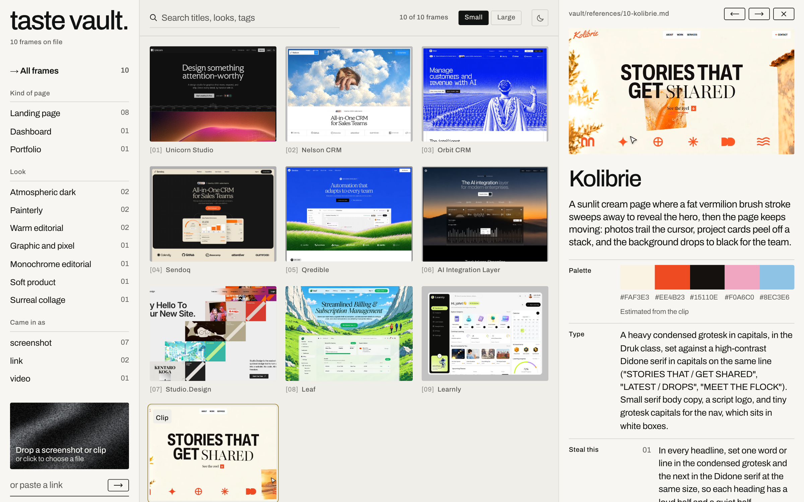

<div align="center">

# taste vault.

**Your design references, written down so your coding agent can read them.**

Drop in screenshots and links. Claude Code writes each one a short style sheet (vibe, palette, type, three moves worth stealing) and files it by kind of page and look. When you start a new front end, your agent works from your taste instead of a blank prompt.


</div>

<p align="center">
  <picture>
    <source media="(prefers-color-scheme: dark)" srcset="docs/screenshot-dark.png">
    
  </picture>
</p>

## Why

Ask an AI to design something and you get the average of the internet. Telling it your taste in adjectives ("clean, editorial, a bit playful") barely helps. Showing it real references does, but only if the agent can find them and knows what you liked about each one.

Taste Vault keeps those references as plain files in a folder, an image plus a short Markdown note for each. Any coding agent can read them, and the app gives you a calm place to browse them.

## Features

- **Two ways in.** Drop a screenshot from Pinterest, Dribbble or anywhere else, or paste a link to a live site.
- **Notes written for you.** Claude Code writes each reference's notes: a one-line vibe, the palette, the type, and three concrete moves you could reuse.
- **Real values from links.** For links, a headless browser captures the page and reads its actual fonts, colours and radii. Notes for screenshots are marked as estimates.
- **Filed automatically.** Each reference is sorted by kind of page (Landing page, Portfolio, Dashboard…) and by look (Monochrome editorial, Painterly…), so you can filter the sheet.
- **Your note matters most.** Write why you kept something. It saves straight into the notes file, and agents are told to weigh it above everything else.
- **Plain files.** No database and no account. Back the vault up, sync it or edit it in any editor. The app updates live when files change.
- **Light and dark.** Follows your system setting, or press `L`.

## How it works

```
  drop a screenshot ─┐
                     ├─▶  vault/inbox/  ──▶  Claude Code  ──▶  vault/references/
  paste a link ──────┘     waiting          writes notes,       07-linear.md
                                            captures links      07-linear.jpg
```

The app never calls an AI service itself. Adding references is a step you run in Claude Code, using the instructions in [`.claude/skills/taste-vault/SKILL.md`](.claude/skills/taste-vault/SKILL.md). Claude Code uses your own account, and nothing leaves your machine except visits to the sites you ask it to capture.

## Getting started

You need [Node.js 22 or later](https://nodejs.org) and [Claude Code](https://claude.com/claude-code).

```bash
git clone https://github.com/chow-stack/taste-vault.git
```

```bash
cd taste-vault
```

```bash
npm install
```

To capture links, download the headless browser once (about 100 MB). You can skip this if you only use screenshots.

```bash
npm run setup
```

Start the app:

```bash
npm run dev
```

Then open **http://localhost:4173**.

## Adding references

1. Drop screenshots or short video clips (MP4, MOV or WebM) anywhere on the window, or paste a link into the box in the left rail. They wait under **Waiting for notes**.
2. Click **Copy the request**, then paste it into Claude Code, opened in this folder.
3. Claude captures any links, writes the notes and files each reference. The frames appear on the sheet as each one is written.

Clips play on the sheet when you hover over them. Claude reads them as a series of stills and adds a **Motion** section: what sets the motion off, what moves, in what order, and roughly how long it takes. This needs ffmpeg (`brew install ffmpeg`). Clips work best when they're under about 20 seconds and show one interaction.

Click a frame to open its notes. Write your own in **My note**; it saves to the file as you type.

| Key | Action |
| --- | --- |
| `/` | Search |
| `←` `→` | Previous or next reference |
| `Esc` | Close the notes panel |
| `L` | Switch between light and dark |

## Using your vault in other projects

The references are plain files, so point your agent at them when you start front-end work:

> Read the references in `~/taste-vault/vault/references` filed under `page: Landing page`, look at their images, and use them as the visual direction. Give the most weight to my notes.

In the app, **Copy these notes for Claude** puts one reference's notes on your clipboard, with the path to its file, ready to paste into another project.

## The notes file

Each reference is an image and a Markdown file with YAML frontmatter:

```markdown
---
id: "07"
title: Linear
kind: Product landing page
source: link
url: https://linear.app/
image: 07-linear.jpg
page: Landing page
look: Monochrome editorial
tags: [dark, product, grotesk, gradient, precise]
measured: true
---

# Linear

> Near-black product shots floating on a quiet grid; the gradient does the selling.

## Palette
- Night: `#08090A`
- Mist: `#F7F8F8`
- Iris: `#5E6AD2`

## Type
...

## Steal this
- ...

## My note
Why you kept it.
```

The full format and the filing rules are in [`SKILL.md`](.claude/skills/taste-vault/SKILL.md).

## Configuration

Set these environment variables when you need them:

| Variable | Default | What it does |
| --- | --- | --- |
| `TASTE_VAULT_DIR` | `./vault` | Keep the vault somewhere else, such as a synced folder |
| `PORT` | `4173` | Port for the app |
| `API_PORT` | `PORT + 1` | Port for the API in development |

`npm start` builds the app and serves it on a single port, without the dev tooling.

Your references and inbox are listed in `.gitignore`, so they stay on your machine even if you fork the repo publicly. To keep your vault in git, delete those lines.

## Can I host it?

It isn't built for that. Taste Vault is a local tool: it writes to your disk, has no login, and its server refuses any request not addressed to `localhost`. Serverless hosts like Vercel or Netlify also have no lasting disk to keep the vault on. Run it on your own computer, and see [SECURITY.md](SECURITY.md) for why.

## Project structure

```
src/
  client/          React app (Vite)
    components/    one component per file, each with its own CSS
    styles/        design tokens (dark and light) and base styles
    lib/           API client, hooks, filtering and layout
  server/          Hono server: the vault API and file access
  shared/          types and helpers used by both sides
scripts/
  capture.ts       Playwright capture of a live site
vault/
  references/      your references: one .md and one image each
  inbox/           items waiting for notes
.claude/skills/    instructions Claude Code follows to write notes
```

## Development

```bash
npm run check
```

That runs the type checker, ESLint and the tests (Vitest). The stack is TypeScript, React 19, Vite, Hono on Node, Zod and Playwright.

## License

[MIT](LICENSE)
